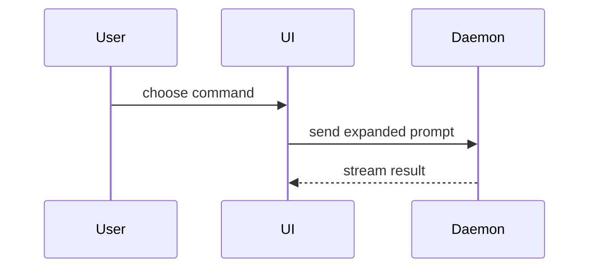

Help the user understand the current topic of conversation visually. Skip the preamble and keep prose brief. Pick the smallest view that makes the key point clear.

- Show logic or an algorithm as pseudocode:

```text
on(save)
  if content is unchanged
    return cached result
  write new content
  return fresh result
```

- Show runtime control flow as a call tree:

```text
submitForm
  createSession
    persistPrompt
    launchAgent
  navigateToSession
```

- Show UI structure as a component tree, including state and module boundaries that matter:

```tsx
<SessionPage> (apps/example/src/routes/session.tsx)
  useSessionEvents()
  <SessionToolbar>
    <RunSkillButton> (packages/ui)
```

- Show file responsibility or a broad refactor as a shallow file tree:

```text
src/
├── commands/       # parses user actions
├── sessions/       # owns session state
└── transport/      # sends API requests
```

- Show component interaction, control flow, or data flow with Mermaid:



- Use `diff` when the point is what changes and the surrounding shape already exists. Match the diff shape to the topic.

For a component change:

```diff
 <SessionPage>
   useSessionEvents()
   <SessionToolbar>
+    <RunSkillButton />
   <SessionTimeline>
+    <SkillResultCard />
```

For a file-layout change:

```diff
 src/
 ├── commands/
+│   └── show-me.ts       # expands the slash command
 ├── sessions/
-└── transport.ts
+└── transport/
+    ├── client.ts
+    └── stream.ts
```

For a call-tree or call-stack change:

```diff
 submitForm
   createSession
     persistPrompt
+    expandSkillMention
     launchAgent
-  navigateToSession
+  navigateToSession
+    subscribeToEvents
```

For a state or control-flow change:

```diff
 on(save)
-  write content
+  if content is unchanged
+    return cached result
+  write new content
+  invalidate cache
```

- Show the whole block when most of it is new, when omitted context would hide ownership or order, or when the user needs a copyable target shape:

```ts
function expandSkill(command: string): string {
  const skillName = command.slice(1)
  return `use the ${skillName} skill`
}
```

- When the point needs more than a chat reply holds (several views side by side, a UI state, a screenshot to point at), publish one Markdown doc with Drop's `publish` tool (`lifetime: "temporary"` unless the user wants to keep it) and give the user the link it returns. Drop renders Mermaid (up to four diagrams), tables, alerts, `diff` and code blocks, and annotated screenshots with comark-annotate:

```md
::screenshot{src="https://example.com/settings.png" alt="Settings page"}
:::annotation{x=12 y=30 w=40 h=8 side="right"}
The save button moves here.
:::
::
```

Marks, colors, and `::compare` for before and after are in the [comark-annotate docs](https://comark-annotate.onmax.me). Screenshots must be https URLs; publish a local one to Drop with `publish` and `file`, and use the `fileUrl` it returns.

- Write HTML (`format: "html"`) only when Markdown can't show the point: an interactive diagram, a custom layout, or a short slide deck. Match the product's colors, type, spacing, and components; use real labels and data; support desktop and mobile.

If Drop's tools aren't available, write the file to the system's temporary directory and open it for the user.

### guidance

Place each visual next to the short text it supports. Keep only the calls, files, props, states, and boundaries needed to answer the user's current question or the options to resolve the current discussion point.

You may use one of these, you may use several, it is unlikely you will use all of them. Use your judgement and don't overwhelm the user.
