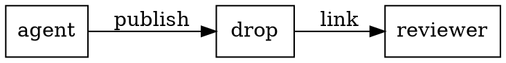

# Blocks in Drop

Drop renders every block from [comark-ui](https://comark-ui.onmax.me). Pick the block from the table, copy its example, and change the content. Each section links the plugin's page with its full syntax.

Drop reads no files, so a block that points at one (`src` on `::table`, `::tests`, or `::cast`) shows a problem instead. Paste the data into the block, as the examples here do.

| To show | Write |
| --- | --- |
| Steps to follow in order | [steps](#steps) |
| The same thing for each OS, package manager, or option | [tabs](#tabs) |
| Detail most readers can skip | [details](#details) |
| Links to the next pages | [cards](#cards) |
| A component's props or a command's options | [fields](#fields) |
| A project's files | [a file tree](#file-trees) |
| A suggested code change | [a diff](#diffs) |
| A file's code, with lines marked or explained | [code titles, marks, and notes](#code-titles-marks-and-notes) |
| Numbers that moved, or progress | [metrics](#metrics) |
| Rows of data | [a data table](#data-tables) |
| A trend or a comparison | [a chart](#charts) |
| A test run | [test results](#test-results) |
| A terminal session | [a terminal recording](#terminal-recordings) |
| Where claims come from | [numbered sources](#sources) |
| Numbered figures and tables | [figures and references](#figures-and-references) |
| A doc's status, PR, and author | [properties](#properties) |
| Contents at the top | [a table of contents](#table-of-contents) |
| A version or a status | [a badge](#badges) |
| A shortcut | [keys](#keys) |
| A phrase to notice | [a highlight](#highlights-and-superscripts) |
| An edit to suggest in the text | [CriticMarkup](#suggested-edits) |
| Terms and their meaning | [a definition list](#definition-lists) |
| An icon | [an icon](#icons) |
| Colors | [swatches and palettes](#colors) |
| A link for a phone | [a QR code](#qr-codes) |
| A recording | [a video or audio file](#video-and-audio) |
| A YouTube, Vimeo, Loom, Spotify, CodePen, or Figma link | [an embed](#embeds) |
| Several screenshots in one place | [a carousel](#carousels) |
| A table or block to see larger | [a zoom](#zoom) |
| A PlantUML, Graphviz, D2, DBML, or ASCII diagram | [a diagram](#diagrams) |
| A question to check, a poll, or a card to recall | [a quiz](#quizzes) |

## Steps

```md
::steps
### Install
Run `pnpm install`.

### Configure
Copy `.env.example` to `.env`.

### Start
Run `pnpm dev`.
::
```

Each `###` heading starts a numbered step. [comark-steps](https://comark-ui.onmax.me/steps/)

## Tabs

````md
::tabs{sync="os"}
:::tabs-item{label="macOS"}
Press **⌘K** to search.
:::

:::tabs-item{label="Windows"}
Press **Ctrl+K** to search.
:::
::

::code-group
```sh [pnpm]
pnpm add drop-client
```
```sh [npm]
npm install drop-client
```
::
````

`sync` switches every tab group with the same name together. `::code-group` turns fences into tabs named by their `[label]`. [comark-tabs](https://comark-ui.onmax.me/tabs/)

## Details

```md
::details{summary="Why the migration runs twice"}
The first run adds the column, and the second fills it once the deploy is live.
::

::accordion
:::accordion-item{label="Who reviews this?"}
The owner of each folder it touches.
:::

:::accordion-item{label="When does it ship?"}
After the review, on the next deploy.
:::
::
```

`::collapsible` hides a block behind a Show and Hide toggle. [comark-details](https://comark-ui.onmax.me/details/)

## Cards

```md
::card-group
:::card{title="Review guide" icon="lucide:book-open" to="https://drop.vitehub.dev/docs/review"}
How to comment and resolve.
:::

:::card{title="Self-host" icon="lucide:server" to="https://drop.vitehub.dev/docs/self-host"}
Run Drop on your own Worker.
:::
::
```

`::columns` with `:::column` lays out any blocks side by side. [comark-cards](https://comark-ui.onmax.me/cards/)

## Fields

```md
::field-group
:::field{name="title" type="string" required}
The doc's title. Defaults to its first heading.
:::

:::field{name="lifetime" type="string" default="review"}
How long the drop stays: `temporary`, `review`, or `keep`.
:::
::
```

[comark-fields](https://comark-ui.onmax.me/fields/)

## File trees

````md
::file-tree
```
server/
  utils/
    publish.ts  # checks the doc
  routes/
package.json
```
::
````

A `#` comment after a name becomes its note. [comark-file-tree](https://comark-ui.onmax.me/file-tree/)

## Diffs

````md
::diff{label="Suggested change"}
```ts [server/utils/publish.ts]
if (issues.length) throw error
```
```ts
if (issues.annotations.length) throw error
```
::
````

The first fence is the code as it is, the second as it should be. [comark-diff](https://comark-ui.onmax.me/diff/)

## Code titles, marks, and notes

````md
```ts title="server/limits.ts" ins={3} del={2} showLineNumbers
export const limits = {
  drops: 10,
  drops: 50,
}
```

```ts [server/count.ts]
const rows = await db.select().from(drops) // <1>
return rows.length // <2>
```

1. One query for the whole list.
2. Counts in memory, since the list is short.
````

`ins`, `del`, and `mark` take line ranges such as `{2-4}`, and `collapse={5-9}` folds lines. A `// <1>` comment points at the item with that number in the list after the block. [comark-code](https://comark-ui.onmax.me/code/), [comark-code-notes](https://comark-ui.onmax.me/code-notes/)

## Metrics

```md
The bundle went from :delta{from=412 to=388 unit="kB" better="lower"}, and the migration is :progress{value=0.6 label="Migrated"}.

::stats{better="lower"}
| Metric | Before | After |
| --- | --- | --- |
| JavaScript | 412 kB | 388 kB |
| Largest paint | 2.4 s | 1.9 s |
::
```

`better` says which way is good, so the change shows green or red. [comark-metrics](https://comark-ui.onmax.me/metrics/)

## Data tables

````md
```csv
Route,Before (ms),After (ms)
/drops,180,95
/d/:link,240,130
```

::table{sort}
```json
[
  { "team": "Web", "open": 4 },
  { "team": "API", "open": 9 }
]
```
::
````

A ` ```csv ` or ` ```tsv ` fence becomes a table with Copy CSV and Copy Markdown buttons. `::table{sort}` makes its headers sort. [comark-table](https://comark-ui.onmax.me/table/)

## Charts

```md
::chart{title="Reviews per day" type="bar"}
| day | reviews |
| --- | --: |
| Monday | 3 |
| Tuesday | 7 |
| Wednesday | 5 |
::
```

The first column is the x axis and each other column a series. `type` is `line`, `bar`, `area`, `scatter`, or `pie`. [comark-charts](https://comark-ui.onmax.me/charts/)

## Test results

````md
::tests{title="Unit tests"}
```xml
<testsuites time="1.2">
  <testsuite name="publish.test.ts">
    <testcase name="publishes a doc" time="0.4"/>
    <testcase name="refuses an empty doc" time="0.2">
      <failure message="expected 400, got 200">AssertionError: expected 400, got 200</failure>
    </testcase>
  </testsuite>
</testsuites>
```
::
````

Paste a JUnit XML report into the fence. [comark-tests](https://comark-ui.onmax.me/tests/)

## Terminal recordings

````md
::cast{title="pnpm test"}
```json
{"version": 2, "width": 40, "height": 4}
[0.2, "o", "$ pnpm test\r\n"]
[0.8, "o", "\u001b[32m✓\u001b[39m 12 tests passed\r\n"]
```
::
````

Paste an asciinema v2 cast: a header line, then one event per line. Colors come through. [comark-cast](https://comark-ui.onmax.me/cast/)

## Sources

```md
Cold starts dropped by half :cite[1], and the new cache keeps them there :cite[2].

::sources
1. [Workers cold starts](https://developers.cloudflare.com/workers/)
2. [KV caching](https://developers.cloudflare.com/kv/)
::
```

[comark-sources](https://comark-ui.onmax.me/sources/)

## Figures and references

```md
The new toolbar is in :ref{#fig-toolbar}.

{#fig-toolbar}


```

An id that starts with `fig-` or `tbl-` numbers an image or a `::table`, and `:ref` to it reads as "Figure 1". An image's title becomes its caption, on an image without an id. [comark-xref](https://comark-ui.onmax.me/xref/), [comark-figure](https://comark-ui.onmax.me/figure/)

## Properties

```md
---
status: Ready for review
pr: https://github.com/vite-hub/drop/pull/54
author: onmax
date: 2026-10-24
---

The plan starts here.
```

`status`, `pr`, `author`, `date`, and `tags` in the front matter show as a box at the top. [comark-properties](https://comark-ui.onmax.me/properties/)

## Table of contents

```md
::toc
::

## Problem

## Plan
```

[comark-outline](https://comark-ui.onmax.me/outline/)

## Badges

```md
Retries :badge[beta]{color="warning"} on every route :badge[v2]{color="info"}.
```

`color` is `primary`, `neutral`, `info`, `success`, `warning`, or `error`. [comark-badge](https://comark-ui.onmax.me/badge/)

## Keys

```md
Press ++ctrl+shift+k++ to open the command menu, and ++esc++ to close it.
```

[comark-keys](https://comark-ui.onmax.me/keys/)

## Highlights and superscripts

```md
The deploy waits while ==a migration is pending==, which happens 2^nd^ in the queue.
```

[comark-mark](https://comark-ui.onmax.me/mark/)

## Suggested edits

```md
The limit is {--ten--}{++fifty++} drops, counted {~~daily~>monthly~~} for {==every team==}{>>Including the free plan?<<}.
```

CriticMarkup: `{++add++}`, `{--remove--}`, `{~~old~>new~~}`, and `{==text==}{>>a comment<<}`. [comark-critic](https://comark-ui.onmax.me/critic/)

## Definition lists

```md
Drop
: A doc, app, or file shared for review.

Lifetime
: How long a drop stays before it expires.
```

[comark-deflist](https://comark-ui.onmax.me/deflist/)

## Icons

```md
Merge once :icon{name="lucide:circle-check"} checks pass.
```

Any [Iconify](https://icones.js.org) name, `set:icon`. Cards, details, and tabs take the same names in `icon`. [comark-icon](https://comark-ui.onmax.me/icon/)

## Colors

```md
The button moves from `#3b82f6` to `oklch(0.55 0.2 264)`.

::palette
- Background: `#fafaf9`
- Primary: `oklch(0.55 0.2 264)`
::
```

A color in inline code gets a swatch. [comark-colors](https://comark-ui.onmax.me/colors/)

## QR codes

```md
Open the preview on your phone: :qr{value="https://drop.vitehub.dev"}
```

[comark-qr](https://comark-ui.onmax.me/qr/)

## Video and audio

```md
{loop muted}
```

An image link to an `.mp4`, `.webm`, `.mov`, `.mp3`, `.ogg`, or `.wav` file plays as a video or audio. Publish the recording with `file` and link its `fileUrl`, as with an image. [comark-media](https://comark-ui.onmax.me/media/)

## Embeds

```md
::embed{url="https://www.youtube.com/watch?v=KCrXgy8qtjM" title="Vite in 100 seconds"}
::
```

[comark-embed](https://comark-ui.onmax.me/embed/)

## Carousels

```md
::carousel{title="Before and after"}


::
```

[comark-carousel](https://comark-ui.onmax.me/carousel/)

## Zoom

```md
::zoom{title="Retry policy"}
| Attempt | Wait |
| --- | --- |
| 1 | 1 s |
| 2 | 4 s |
::
```

A click opens the block full screen. Images zoom on their own. [comark-zoom](https://comark-ui.onmax.me/zoom/)

## Quizzes

```md
::question{#event-loop-order}
Which callback runs first once the current script ends?

- [x] A resolved promise's `then` callback
  > Promise callbacks are microtasks, which run before the next task.
- [ ] A `setTimeout(fn, 0)` callback
  > A timer queues a task, which waits for the microtasks.

#explain
After every task, the event loop empties the microtask queue.
::

::poll{#next-lesson}
What should the next lesson cover?

- [ ] Web Workers
- [ ] Streams
::

::recall{#why-microtasks}
Why does a promise callback run before a zero-delay timer?

#answer
Promise callbacks are microtasks, and a timer's callback is a task.
::
```

Give each block an `#id` and keep it across versions. Mark the right options with `[x]` and put a `>` reason under every option. `#hint` adds a hint to a question. Options are shuffled, so don't write "All of the above". [comark-quiz](https://comark-ui.onmax.me/quiz/)

## Diagrams

````md

````

` ```plantuml `, ` ```graphviz ` (or ` ```dot `), ` ```d2 `, ` ```dbml `, and ` ```goat ` (or ` ```svgbob `) fences draw through [Kroki](https://kroki.io), which sees the diagram's source. Use [Mermaid](markdown.md#mermaid), drawn by Drop itself, for anything private. [comark-diagrams](https://comark-ui.onmax.me/diagrams/)

## Links

Every web link shows as a chip with its site's icon, and `@user` as a chip with their GitHub avatar. Add `{chip=false}` after a link to keep it plain: `[the guide](https://vite.dev/guide/){chip=false}`. `owner/repo#12` links to that issue or pull request, and each heading gets a link to itself. [comark-chips](https://comark-ui.onmax.me/chips/), [comark-github](https://comark-ui.onmax.me/github/), [comark-links](https://comark-ui.onmax.me/links/)

Inline HTML that GitHub allows, such as `<kbd>`, `<sub>`, and `<details>`, renders as on GitHub. Bold and italics also work next to Chinese, Japanese, and Korean punctuation ([comark-cjk](https://comark-ui.onmax.me/cjk/)).
