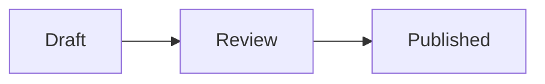

# Markdown in Drop

Drop renders only the syntax on this page and the [blocks](blocks.md) it links. Comark supports more, but here the rest shows up as plain text or as an "Unsupported component" box. Publish `html` when a doc needs its own layout.

| To show | Write |
| --- | --- |
| A note, tip, decision, or risk | [an alert](#alerts) |
| A flow, a sequence, or how parts relate | [a Mermaid diagram](#mermaid) |
| Where a claim comes from | [a footnote](#footnotes) |
| Code | [a fenced block with its language](#code) |
| Progress on a list of steps | a task list: `- [x] done`, `- [ ] next` |
| A screenshot with marks, or a before and after | [an annotated screenshot](#annotated-screenshots) |
| Steps, tabs, cards, a diff, metrics, a data table, a chart, test results, and more | [a block](blocks.md) |

Headings, lists, tables, links, `~~strikethrough~~`, and `` images work as in GitHub. A bare `https://` URL becomes a link, and every web link shows as a chip with its site's icon ([links](blocks.md#links)).

## Live editing

People can edit a doc together in the browser (`share: team_edit`), but only if it has no components (`::name` blocks or inline ones such as `:badge[beta]`), no footnotes, and no [suggested edits](blocks.md#suggested-edits). A doc with any of them is read-only in the editor. For a doc the team will edit, use plain Markdown, alerts, Mermaid, and code blocks.

## Alerts

```md
> [!IMPORTANT]
> **Decision:** keep the existing endpoint. Clients pin its response shape.
```

| Kind | Use it for |
| --- | --- |
| `NOTE` | Context the reader needs before the next step |
| `TIP` | A shortcut or a better way to do something |
| `IMPORTANT` | A decision or requirement. Start with a bold label such as `**Decision:**` |
| `WARNING` | A risk the reader should check |
| `CAUTION` | An action that loses data or can't be undone |

An alert can hold several paragraphs, lists, and code. The components `::alert`, `::callout`, `::caution`, `::important`, `::info`, `::note`, `::tip`, and `::warning` draw the same box without the label, so write an alert instead.

## Code

````md
```ts {2}
const drop = await publish({ markdown })
const url = drop.url
```
````

Use a common language name or alias such as `ts`, `py`, or `sh`. An unknown language or a missing one gives plain text. `{2}` highlights line 2. `{1,3-5}` highlights lines 1 and 3 to 5.

## Code changes

````md
::diff{line=14}
```ts [server/api/drops.get.ts]
const limit = 20
```
```ts
const limit = Number(getQuery(event).limit ?? 20)
```
::
````

`::diff` shows one file's lines before and after, with the file, line numbers, and the changed words marked. Copy real lines from the change. The full syntax is in [the annotation reference](https://drop.vitehub.dev/.well-known/skills/pr-evidence/references/annotations.md#diff).

## Mermaid

````md

````

Drop draws the diagram on the server. Use one per doc when you can: a doc shows at most 4 diagrams and 8,000 characters of Mermaid. Past that, or when the source is invalid, the diagram shows as its source text.

## Footnotes

```md
Cold starts dropped to 40 ms.[^bench]

[^bench]: Median of 200 requests on the staging Worker, 2026-10-14.
```

Drop numbers them in order and lists them under a Footnotes heading at the end. A definition can hold links, bold, and code. [comark-footnotes](https://comark-ui.onmax.me/footnotes/)

## Annotated screenshots

```md
::screenshot{src="https://example.com/settings.png" alt="Settings page with the Save button below the fold" viewport="1440x900"}
:::annotation{x=72 y=88 w=20 h=8 color="red"}
Save sits below the fold on a laptop screen.
:::
::
```

`::screenshot` marks areas of an image, and `::compare` puts two screenshots side by side as before and after. `src` takes an `https://` URL or the `fileUrl` of an image published with `file`. Before you write marks or a comparison, read the full syntax in [the annotation reference](https://drop.vitehub.dev/.well-known/skills/pr-evidence/references/annotations.md). When the syntax is wrong, `publish` fails and lists every problem. [comark-annotate](https://comark-ui.onmax.me/annotate/)

## Front matter

```md
---
title: Publish permanent plans
supersedes: https://drop.vitehub.dev/d/k7f2q9/publish-plans
---
```

Set `title` when the first heading isn't the doc's title. Add `supersedes`, the link of a separate doc this one replaces, only when the reader needs to see that link. A new version of the same drop goes through `previous`, which keeps the history on the drop page.

## What Drop doesn't render

| Written | Shows as | Write instead |
| --- | --- | --- |
| `$x^2$` math | the dollar signs and source | a code span or a `text` block |
| `:rocket:` | an "Unsupported component" box | the emoji itself, when it carries meaning |
| `#123` | plain text | `owner/repo#123`, or a full link: `[#123](https://github.com/owner/repo/pull/123)` |
| `<script>`, `<style>`, `<iframe>`, or a tag GitHub doesn't allow | nothing | Markdown, a [block](blocks.md), or publish `html` |

A word that starts with a colon, such as `:name`, also renders as an "Unsupported component" box. In prose, attach the colon to the word before it: `Note: text`, `key:value`, and `10:30` stay plain.
